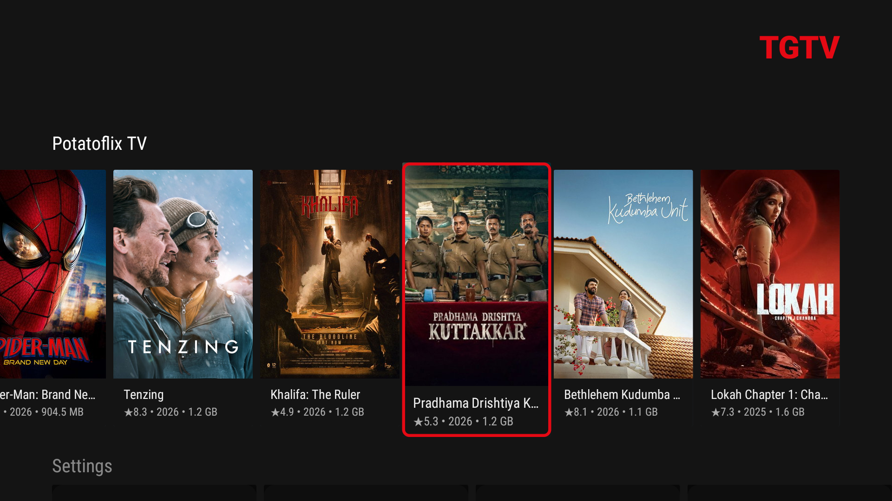
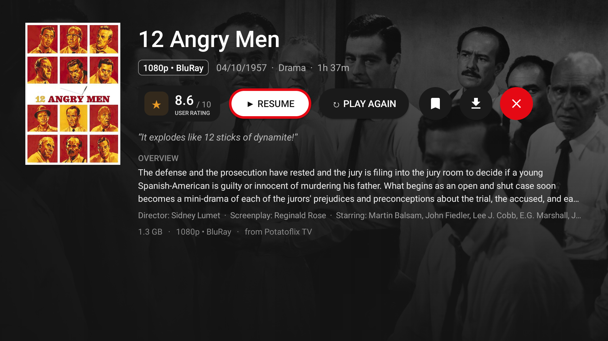

# TGTV

[](https://github.com/aravindbuilds/TelegramVideoTV/releases)
[](#supported-versions)
[](LICENSE)

**Turn your Telegram into a private Netflix for your TV.** TGTV is a free, open-source
Android TV app that you sideload onto your Android TV to browse, stream and download videos stored
in your Telegram account — Saved Messages, private library groups, channels.
No ads. No upload limits. Your Telegram account *is* the server.

<picture>
  
</picture>
<picture>
  
</picture>

- **Runs on**: Xiaomi Mi Box, NVIDIA Shield, Fire TV (sideload), Chromecast with Google TV, and any Android TV running Android 8.0+
- **Works with**: Telegram groups, channels, Saved Messages — videos travel as documents and still play
- **Stack**: Kotlin · TDLib · Leanback · Media3 / ExoPlayer

**Start here:** [Install on your TV](#1-install-tgtv-on-your-tv) → [Create a bot token](#2-get-a-bot-token) → [Log in](#3-log-in-on-the-tv). Two 5-minute steps.

## What's new in v1.1

- **No API keys needed on the TV** — the shared Telegram app credentials are compiled into
  the release APK, so setup is now just the @BotFather token (or skip that too and log in
  with your Telegram account by QR).
- **Resume playback** — where you left off is saved locally; the details screen offers
  **Continue** / **Play Again**, and titles watched to the end are marked as seen.
- **In-player settings panel** (press MENU or INFO while playing): switch subtitle and
  **audio tracks**, playback speed (0.25x–2x) and a **resolution cap** (Auto/4K/1080p/…) without leaving the video. Hold MENU for a quick subtitles on/off.
- **Your library survives restarts** — chats and videos are indexed in a local SQLite
  database, so even bot mode (which Telegram doesn't allow to read history) reopens
  full library instantly after a cold start.
- **Remove from TGTV** — long-press → *Remove* hides a title from the TV only; the
  Telegram post stays untouched, hidden titles stay hidden across scans.
- **Zero-credential login on TV** — with baked credentials the login screen goes
  **straight to the QR "Link device"** flow, no forms.
- Subtitles now render at the bottom of the **TV screen** (not the letterboxed video),
  with a Small/Medium/Large size setting; audio pauses no longer risk the box sleeping
  during playback (wake lock held); details screen shows **cast & crew** (via TMDB
  credits) and a quality badge (1080p, 4K, WEB-DL…) on the hero.

## Features

**Library & browsing**
- Netflix-style TV UI — poster rows, focus navigation with the remote, black + red theme
- One row per chat, newest videos first, real video-frame thumbnails on every card
- Every video gets a **details screen**: full-bleed TMDB backdrop, ★ rating, runtime,
  status, overview, genres, cast & director, and Play / Add to Watchlist / Download buttons
- **TMDB metadata built in** — files are identified by parsing their release-style name
  (quality tags, audio languages, group junk), with spelling-tolerant retries and a
  web-assisted fallback (Wikipedia / DuckDuckGo → canonical title → TMDB)
- **Version picker** — multiple files of the same title (1080p vs 720p, language cuts)
  are grouped on the details screen with size/quality/audio labels
- **My List** — watchlist bookmarked locally on the device

**Playback**
- Streaming via TDLib range downloads read straight from the partial local file
  (no Bot API 20 MB limit, no external file hosts)
- Seek anywhere — data is fetched from the seek position, not the file start
- YouTube-style time-based buffering: starts with ~2 s buffered, look-ahead grows to
  5 minutes of video
- **Resume / Continue watching** — position saved locally, cleared after finishing
- Embedded subtitles plus **OpenSubtitles.com fallback** (bring your own free API key:
  Settings → Subtitles) matched by TMDB ID and side-loaded without losing position
- Player settings: subtitles/audio track/speed/quality cap, reachable from MENU/INFO
  and the on-screen gear button

**Storage & downloads**
- Full download to `Movies/TgTV` via MediaStore on API ≥ 29, private app dir on older
  devices; foreground service with progress notifications
- **Cache hygiene** — a video's cached bytes are deleted 20 s after you exit it, and
  the whole TDLib cache is capped at 2 GB (trimmed LRU to ~1.5 GB)
- **Storage-aware playback** — big files warn at open if free space is insufficient
  and pause before the device runs out of disk

## How it's different from other Telegram TV apps

Other "Telegram to TV" apps forward your file to a **third-party hosting bot** and
stream the resulting public URL. TGTV streams **in-process**: TDLib downloads the byte
ranges the player needs straight onto the device and ExoPlayer reads them from disk —
your files never leave the Telegram network on the way to your screen. No Bot API
20 MB cap, no external player dependency, no public file links. Technical details:
[How streaming works](#how-streaming-works).

---

## Getting started

### 1. Install TGTV on your TV

Grab the APK from [Releases](https://github.com/aravindbuilds/TelegramVideoTV/releases):
**`TGTV-v1.1-v7a.apk`** for any Android TV (~24 MB; works on every device including arm64/x86 ones)
or **`TGTV-v1.1-universal.apk`** for emulators (~96 MB).

Android TVs have no app store for this, so you **sideload** it. Pick whichever method
suits you — all end with the same APK install dialog on the TV.

**Step 0 — allow app installs on the TV (needed by every method)**

1. On the TV open **Settings → Device Preferences (or Apps) → Security & Restrictions**
2. Under **Install unknown apps**, pick the app you will install *from*
   (file manager, Send files to TV, or ADB shell) and toggle **Allow from this source**
3. *(ADB method only)* also enable **Settings → Device Preferences → About → Network →
   tap Build / Android TV OS build 7 times** to unlock
   **Developer options → Network debugging (ADB)**

**Method A — USB drive (no computer, no internet tricks)**

1. Copy `TGTV-v1.1-v7a.apk` to a USB stick (FAT32/exFAT both work)
2. Plug the stick into the TV's USB port
3. Open any **file manager** on the TV (most devices have one; if not, install
   [FX File Explorer](https://play.google.com/store/apps/details?id=nextapp.fx) or
   Solid Explorer from Play Store first)
4. Browse to the stick → **TGTV-v1.1-v7a.apk** → press OK → **Install** → **Open**

**Method B — over Wi-Fi (no USB, no ADB)**

1. Install **[Send Files to TV](https://play.google.com/store/apps/details?id=com.smartsysands.sendfilestotv)**
   on **both** the TV (from Android TV Play Store) and your phone
2. Open it on the TV: **Receive** → note the TV's IP
3. On the phone: **Send** → select the APK → pick the TV's IP → wait for the transfer
4. On the TV, the received APK opens inside the app → **Install**

*(Any LAN transfer app works the same way: LocalSend, TV File Transfer, …)*

**Method C — ADB over the network (last resort)**

From a PC on the same Wi-Fi, in the folder containing the APK:

```powershell
adb connect <tv-ip>:5555      # some devices use :5037, Fire TV shows the port in Settings
adb install -r TGTV-v1.1-v7a.apk
adb shell am start -n com.tgtv.videotv/.ui.MainActivity
```

If `adb connect` fails, enable **Developer options → Network debugging** (Step 0),
or connect once with USB-ADB (Fire TV: Settings → My Fire TV → Developer options).

**Troubleshooting**

| Symptom | Fix |
|---|---|
| "App not installed" mid-install | Internal storage full — delete unused apps / empty app caches, then retry |
| Install button does nothing after "unknown apps" toggle | Re-do Step 0 and toggle the *actual app performing the install* |
| Launch opens nothing | Reboot the TV once after install, then reopen |

### 2. Get a bot token

The release APK has Telegram's app credentials (api_id/api_hash) **built in**, so
this is the only single stop:

1. On your phone open Telegram → search **@BotFather** → send `/newbot`
2. Copy the **bot token** it gives you (format `123456:AAH...`)

### 3. Create your library and log in

1. In Telegram, create a **private group or channel** (e.g. "My TV Library") and
   **add the bot as a member / admin**. This group is your TV library — only what
   you deliberately post or forward there will appear on the TV.
2. On the TV, open TGTV → choose **Bot token** → paste the token → *Save and connect*.
   (Prefer no bot at all? Choose **QR login** on the TV's login screen and scan the
   code with your phone — Settings & Devices → Link Desktop Device — to log in as
   *your own account* with your full chat history.)
3. Post or forward a video into the library group → it should appear as a row
   on the TV within seconds.

> **Upgrading from v1.0:** the API-credentials form is gone on the TV. If the app
> opens with your old session already active, nothing to do; if it asks for
> credentials again, just use the same bot token (or switch to QR login) once.

### Recommended daily use

- Post or forward movies into your library group from your phone — the TV library
  updates **live**.
- Watch part of a movie? The next time you open it, choose **Continue** to resume.
- Long-press a card for **Play / Download / Remove from TGTV**.
- Press **MENU/INFO** while playing for subtitles, audio track, speed and quality cap.

---

## Two login modes — pick the right one

| | **Bot mode (recommended)** | **QR user login** |
|---|---|---|
| Log in as | your @BotFather bot | your own Telegram account |
| Library source | a private group/channel you curate | your real account: every chat & full history |
| History | **live only** (Telegram forbids bots from reading history) | complete archive |
| Curation boundary | total — nothing else from your account ever appears | none — everything the account can see is browsable |
| Resilience | library survives restarts instantly via the local index (v1.1) | same |

**Recommendation:** bot mode as the daily driver — it is the "TV library appliance"
pattern: a private group you own, the bot as librarian, you decide exactly what shows.
QR login when you specifically need old content (pull a channel's full history),
then switch back (Settings → *Sign out*).

In v1.1 the "bots can't read history" limitation mostly disappears in practice: once
a video has been captured live, it is stored in the local library index and shows
again after every restart.

## Known limitations

- **Bot live-only history** — Telegram's server refuses history requests for bot
  accounts. The local index keeps everything the bot has *seen* in this session's DB
  forever, but the first-ever content must arrive once while the app is connected.
  For full history use the **QR phone login**.
- **Exotic codecs** — playback relies on the TV's hardware codecs; AVI/DTS media may
  fail on some Android TVs.
- **Storage during long movies** — streamed bytes are cached by TDLib as they are
  watched (~the whole file by the end of a full playthrough). The cache is purged
  ~20 s after you exit and capped at 2 GB when idle, but *during* playback local
  usage grows with what you've watched. TGTV warns at open and pauses before running
  out, but the practical tip remains: keep what you play under the TV's free
  `/data` space (file size is visible on every card and in the version picker; on a
  Mi Box 4 with ~2 GB free, ≤ ~1.5 GB streams through cleanly).
- One video downloads at a time (foreground service; parallel queue is a TODO).
- Thumbnails are optional — no thumb means a blank card, but the video still plays.

---

## Supported versions

| | |
|---|---|
| **App version** | v1.1 |
| **Android** | 8.0 (API 26) and newer |
| **Tested on** | Xiaomi Mi Box 4 (Android 9, armeabi-v7a) |
| **Variants** | **v7a** (armeabi-v7a only, ~24 MB — recommended for all devices) and **universal** (all 4 ABIs, ~96 MB — emulators / exotic arm64 devices) |
| **Target SDK** | 35 |
| **TDLib** | io.github.tdlib-android:core 0.1.1 (TDLib 1.8) |

## Build from source

The project contains no API secrets. Release builds read `api_id` / `api_hash` at
build time from an **untracked** properties file and bake them (XOR-obfuscated) into
a generated Kotlin object; without one, the app builds fine but shows the good-old
manual-credentials login form. File searched in order:

1. `<project>/secrets.properties`
2. `<parent>/tgtv-secrets.properties`

Both with `api_id=<numeric>` and `api_hash=<hex string from my.telegram.org/apps>`.

**Android Studio:** open the root, let Gradle sync (pulls the ~40 MB
`io.github.tdlib-android:core:0.1.1` AAR from Maven Central), run on a TV or emulator.

**Terminal** (`adb` connected to the TV):

```powershell
# Build both release APK outputs
.\gradlew assembleV7aRelease assembleUniversalRelease   # Gradle 8.11.1+ locally

# APK output (not committed)
app/build/outputs/apk/v7a/app-v7a-release.apk
app/build/outputs/apk/universal/app-universal-release.apk
```

Releases are signed with the debug keystore, so users can install over older versions
without uninstalling.

No wrapper jar is committed: command-line `gradlew` needs a local Gradle
installation; Android Studio's bundled Gradle handles sync/run.

## How streaming works

```
ExoPlayer (progressive) -> TdVideoStreamDataSource.read()
    - 1 KiB-aligned window around the read cursor
    -> TdLib.downloadRange(fileId, offset, limit)     [mutex-serialised,
        synchronous TdApi.DownloadFile — TDLib physically writes the range
        into its partial local file]
    <- read that range straight from the partial file (RandomAccessFile)
```

- Why not `ReadFilePart`? TDLib's `FileManager::read_file_part` rejects any range
  beyond the *contiguous downloaded prefix from byte 0* ("There is not enough
  downloaded bytes in the file to read"), which breaks every stream touching a far
  range (MKV Cues at EOF, MP4 tail atoms). Range `DownloadFile` writes are not
  subject to that gate, so the DataSource downloads the window synchronously and
  reads bytes directly off disk.
- All range downloads share one mutex: TDLib keeps at most one pending
  `DownloadFile` per file — a new request cancels the in-flight one.
- Each DataSource gets a fresh instance: ExoPlayer opens several DataSources
  concurrently (MP4 reads the `moov` trailer at EOF while the main loader reads the
  start) and they must not share mutable state.
- After each window a single 4 MiB fire-and-forget prefetch is queued.
- **Per-video purge:** on player exit the file's pending downloads are cancelled
  and its cache entry deleted after a 20 s grace (so instant replays keep bytes).
- **Global 2 GB cap:** `TdLib.enforceCacheCap()` measures `tdlib_files/` and, when
  over 2 GB, calls `OptimizeStorage(1.5 GB)` so TDLib drops least-recently-used
  files first. Runs after login and after every purge; skipped while streaming.
- **Post-v1.0 re-resolve:** stored library rows keep the file's stable remote id;
  on restart the stale session-local file id is re-resolved to a live one instead
  of breaking playback.

## Full (offline) download path

Long-press a card → `DownloadService` starts (foreground, dataSync):

1. `DownloadFile(fileId, priority=24, offset=0, limit=0)` — whole file, plus
   `UpdateFile` listener for % progress.
2. On `isDownloadingCompleted` → copy `local.path` into `Movies/TgTV/<fileName>` via
   MediaStore (`IS_PENDING` round-trip).
3. `RemoveFileFromDownloads(fileId, deleteFromCache=false)` — drops the manager
   record, keeps the cached bytes.

## Project structure

```
TelegramVideoTV/
├── README.md                          <-- this file
├── settings.gradle.kts                Module graph + Maven Central / Google repos
├── build.gradle.kts                   Root: AGP 8.9.3 + Kotlin 1.9.24 plugins
├── gradle.properties                  JVM args, AndroidX flags
├── secrets.properties*                (untracked) build-time TDLib api_id/api_hash
├── docs/screens/                      README screenshots
└── app/
    ├── build.gradle.kts               v7a/universal ABI flavors; release builds read
    │                                  the BakedApi secrets file above; deps:
    │                                  tdlib-android:core:0.1.1, leanback, media3,
    │                                  zxing (QR), NanoHTTPd (phone pairing), coroutines
    ├── proguard-rules.pro             Keep org.drinkless.tdlib classes
    └── src/main/
        ├── AndroidManifest.xml        Permissions (INTERNET, WAKE_LOCK,
        │                              FOREGROUND_SERVICE+FOREGROUND_SERVICE_DATA_SYNC,
        │                              POST_NOTIFICATIONS), LEANBACK_LAUNCHER intent
        │                              filter, download service, landscape /
        │                              keep-screen-on player activity
        ├── assets/setup.html          The "pair via phone" credential page served
        │                              over the LAN by the embedded HTTP server
        ├── res/
        │   ├── drawable/              Launcher/banner icons, pill/chip backgrounds
        │   ├── layout/                activity_login / activity_details /
        │   │                          activity_player and related views
        │   └── values/                strings.xml  colors.xml  themes.xml
        └── java/com/tgtv/videotv/
            ├── App.kt                 Application: starts TDLib at boot when
            │                          credentials are already saved
            ├── model/
            │   ├── VideoItem.kt       Playable-video data class, incl. the stable
            │   │                      remote file id + kind used to re-resolve
            │   │                      session-stale file ids after a restart
            │   └── VideoMapper.kt     TdApi.Message -> VideoItem (bottom half of
            │                          the streaming pipeline): video / video-note /
            │                          GIF / video-document w/ extension whitelist
            ├── store/
            │   └── VideoLibrary.kt    SQLite index of the library: video refs
            │                          (chat+message, metadata, remote id), hidden
            │                          entries and resume-progress tables — instant
            │                          restart and bot-mode persistence
            ├── td/
            │   ├── Credentials.kt     SharedPreferences for api id/hash/token,
            │   │                      subtitle settings; falls back to baked values
            │   ├── TdError.kt         TDLib error wrapper (code + message)
            │   └── TdLib.kt           Singleton TDLib client: bot + QR user login
            │                          state machines, thread-safe suspend send(),
            │                          cache cap, downloadRange()
            ├── ui/
            │   ├── MainActivity.kt    Activity host; adds the browse fragment
            │   ├── MainBrowseFragment.kt  Leanback BrowseSupportFragment: chat list
            │   │                          (LoadChats + local index), rows, actions
            │   │                          (refresh / pair / sign out / TMDB /
            │   │                          subtitles), card click & long-press
            │   ├── VideoCardPresenter.kt  ImageCardView renderer; lazy thumbnail
            │   │                          decode from TDLib-downloaded thumbs
            │   ├── VideoRow.kt        One row = one chat + its VideoItems
            │   ├── LoginActivity.kt   Bot-token / QR login (baked creds: straight
            │   │                      to QR) + LAN "pair via phone" option
            │   ├── DetailsActivity.kt Details screen: TMDB hero, Continue / Play
            │   │                      Again / Watchlist / Download / Remove
            │   ├── PlayerActivity.kt  Full-screen ExoPlayer: resume, in-player
            │   │                      settings (subs/audio/speed/quality cap),
            │   │                      screen-anchored subtitles, wake lock
            │   └── TdVideoStreamDataSource.kt  Media3 DataSource mapping reads to
            │                          TDLib range downloads (1 MiB), the core of
            │                          Telegram streaming
            └── svc/
                └── DownloadService.kt Foreground service: full file download +
                                       MediaStore Movies/TgTV copy + progress
                                       notification cleanup
```

## Extending it

- **Paging / infinite scroll** (user mode only — bots can't search history):
  `searchChatMessages` with `nextFromMessageId` (already returned in
  `FoundChatMessages`).
- **Storage-curve UI**: expose `TdLib.enforceCacheCap()` and the measured cache size
  as a Settings action ("Clear cache").
- **Multi-download queue**: hold a `ConcurrentLinkedQueue<VideoItem>` in
  `DownloadService` instead of the single-job guard.
- **Scoped library for user mode**: a chat filter so QR sessions can pin only chosen
  groups (currently the account's whole archive is browsable).
